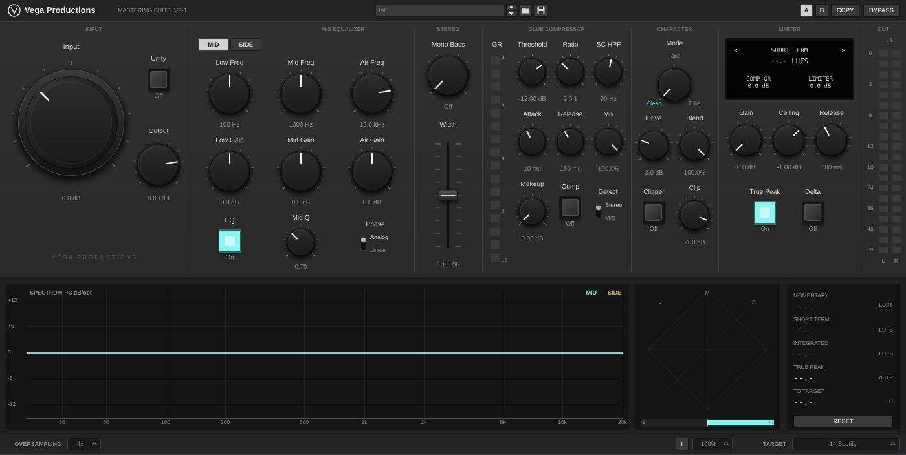

# Vega Productions — Mastering Suite (VP-1)



A full mastering chain in one plugin: VST3 for Windows, plus VST3 and AU for macOS (Apple Silicon and Intel).

## Signal flow

```
Input ─► M/S EQ ─► Width / Mono Bass ─► Glue Comp ─► [Oversampled: Character ─► Clipper] ─► True-Peak Limiter ─► Output
```

| Section | What it does |
|---|---|
| **Input / Output** | Big Input drive knob, Output trim. **Unity** turns the output down by the same amount you push the input, so you can A/B at matched level. |
| **M/S Equalizer** | Separate Low shelf, Mid bell, and Air shelf for **MID** (vocals, kick, snare, bass) and **SIDE** (guitars, synths, ambience). **Phase** switch: *Analog* (minimum-phase, no added latency) or *Linear* (FIR, phase-accurate; adds ~46 ms latency, which your DAW compensates automatically). |
| **Stereo** | **Width** fader (0–200 %) and **Mono Bass**, which sums everything below the chosen frequency to mono for club and vinyl mono-compatibility. |
| **Glue Compressor** | Soft-knee bus compressor with Threshold, Ratio, Attack, Release, Makeup, parallel Mix, and a sidechain HPF so the kick doesn't pump the mix. **Detect**: Stereo-linked or Mid/Side. GR LED column. |
| **Character** | Clean / **Tape** (symmetric, odd harmonics) / **Tube** (asymmetric, even harmonics) with Drive and Blend. |
| **Clipper** | Soft-knee clipper that shaves transients before the limiter. |
| **Limiter** | Look-ahead brick-wall limiter with **true-peak (inter-sample) detection** (8× interpolated). Set Gain, Ceiling (dBTP), and Release. **Delta** lets you hear only what the plugin is changing. |
| **Oversampling** | 1× / 2× / 4× / 8× (linear-phase FIR) for the Character and Clipper stages, to stop aliasing when you push hard. |
| **Metering** | OLED readout (click ‹ › to cycle), output LED meters, spectrum analyzer with the M/S EQ curves drawn on top, phase scope with a correlation meter, and an EBU R128 panel (Momentary, Short-Term, Integrated LUFS, True Peak, distance **To Target**). |
| **Workflow** | Factory presets, Save / Load user presets, **A/B** comparison with **COPY**, Bypass, and 75–150 % UI zoom. |

### Factory presets
Init · Soulful House Master · Streaming -14 LUFS · Club Loud · Gentle Glue · Wide & Airy · Vinyl Warmth · Deep House Low End · Linear Phase Polish

User presets are saved to `Documents/Vega Productions/Mastering Presets`.

---

## Build it on GitHub (step by step)

1. **Create the repo.** On github.com, click **+ → New repository**. Name it `vega-mastering`, leave everything else unchecked, and click **Create repository**.
2. **Upload the files.** Unzip `vega-mastering.zip` on your computer.
   - *GitHub Desktop (easiest):* **File → Add local repository** → pick the unzipped `vega-mastering` folder → **Publish repository**.
   - *Web upload:* on the empty repo page, click **uploading an existing file**, then drag **everything inside** the unzipped folder, including the `.github` folder, into the browser. Click **Commit changes**.
     - The `.github` folder is hidden on Mac (press **Cmd + Shift + .** to show it). If it didn't upload, use **Add file → Create new file**, type `.github/workflows/build.yml` as the name, paste in the contents, and commit.
3. **Watch the build.** Open the **Actions** tab. "Build Vega Mastering" runs automatically and takes about 10–15 minutes. Both jobs also run a DSP self-test that checks the true-peak ceiling and looks for bad audio values.
4. **Download.** Click the finished run and scroll down to **Artifacts**:
   - `VegaMastering-Windows-VST3`
   - `VegaMastering-macOS-VST3-AU`

## Install

**Windows (FL Studio):** unzip, then copy `Vega Productions Mastering.vst3` to `C:\Program Files\Common Files\VST3\`. In FL Studio go to **Options → Manage plugins → Find more plugins**, then load **Vega Mastering** on the Master track.

**Mac (Ableton Live 12 / FL Studio):** unzip, then copy
- `Vega Productions Mastering.vst3` → `~/Library/Audio/Plug-Ins/VST3/`
- `Vega Productions Mastering.component` → `~/Library/Audio/Plug-Ins/Components/`

The plugin is unsigned, so clear the download quarantine once in Terminal:
```
xattr -cr ~/Library/Audio/Plug-Ins/VST3/"Vega Productions Mastering.vst3" ~/Library/Audio/Plug-Ins/Components/"Vega Productions Mastering.component"
```
Then rescan plugins in Ableton (**Settings → Plug-Ins → Rescan**).

## Mastering tips
- Use **4× or 8× oversampling** whenever the Character or Clipper stage is working hard.
- For streaming, set the Ceiling to **-1.0 dBTP**. Adjust limiter **Gain** until **To Target** reads about 0 LU over the loudest full section.
- Toggle **Delta** while adjusting the limiter. If you can hear the groove or the kick in the Delta signal, back off.
- Hit **Unity** before judging EQ or compressor moves, so a louder version doesn't fool your ears.
